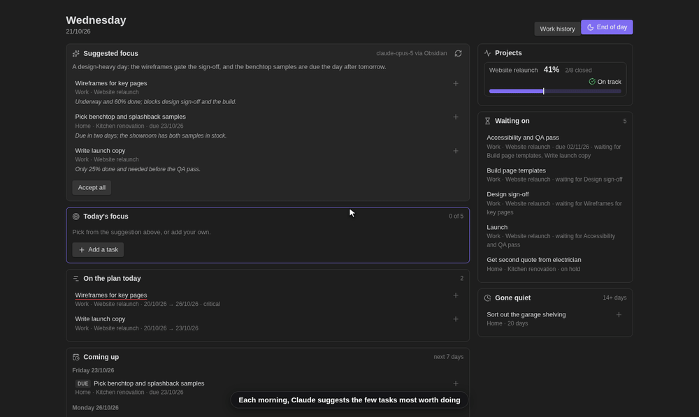
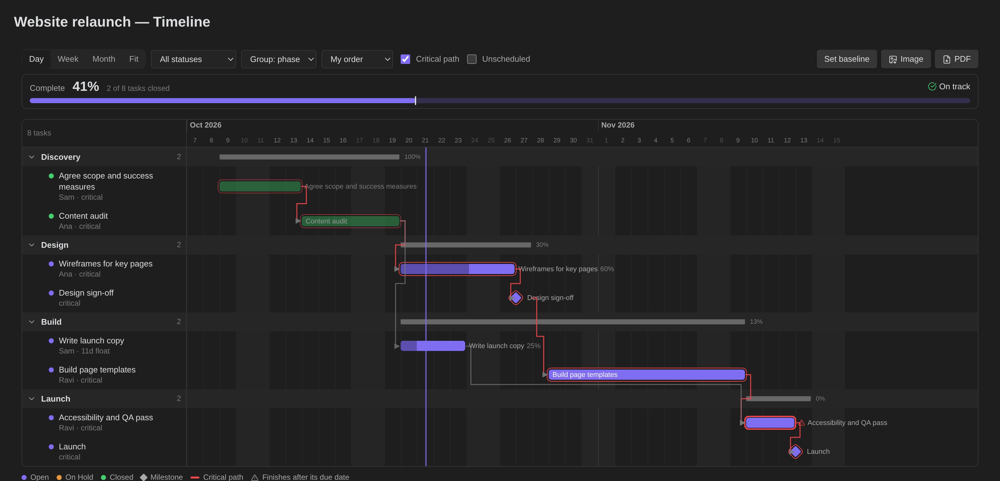
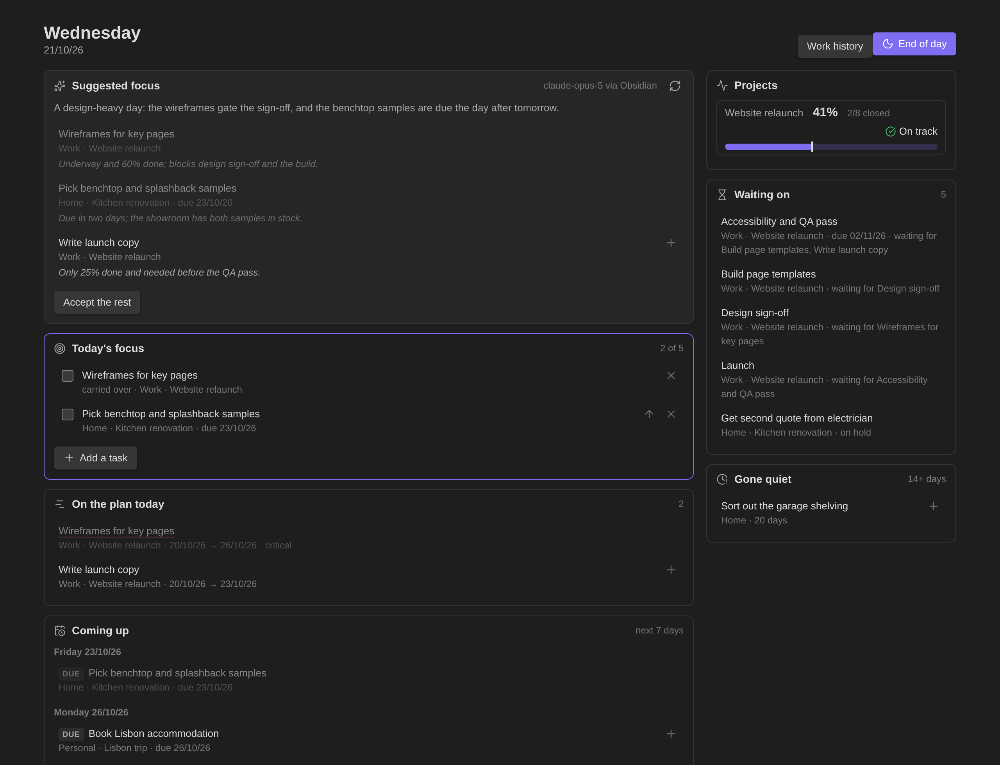
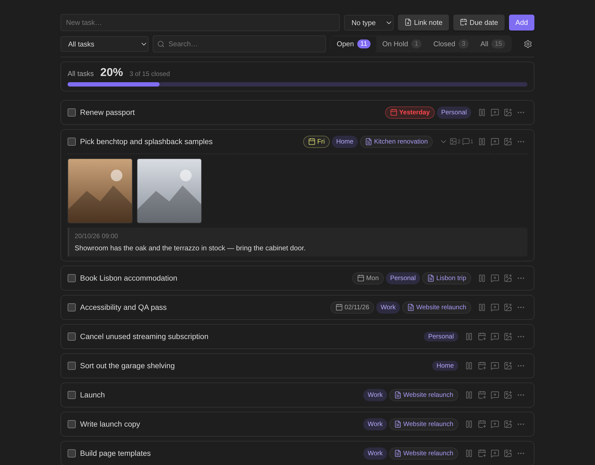
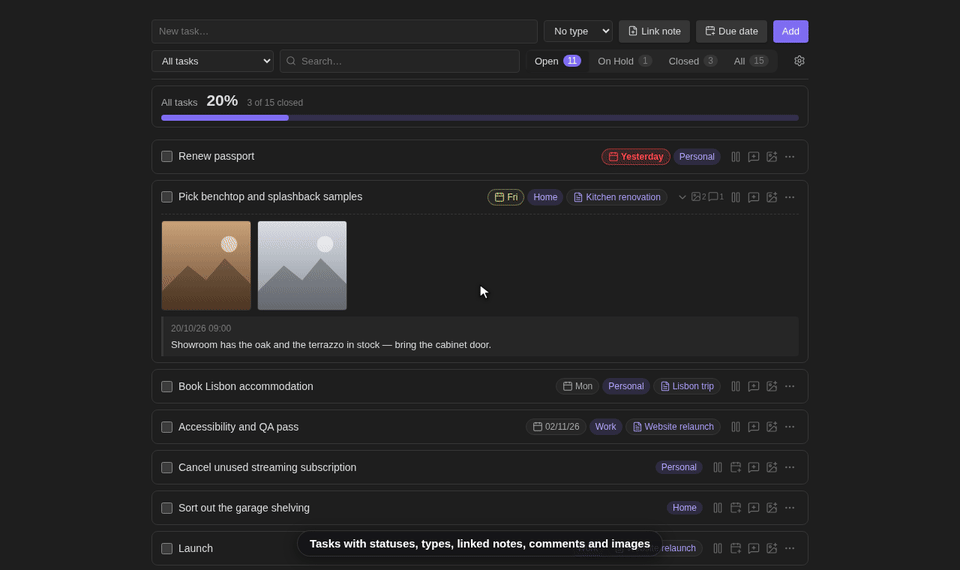

# Focus Hub

An Obsidian plugin for running your tasks and projects from one place: a task list
with statuses, comments and images, a **Today** view that helps you choose what to
work on, and **Gantt timelines** for project notes.

[](https://ko-fi.com/jcolorxy)

> Needs Obsidian 1.13 or later. Works on desktop and mobile.





| Today | Tasks |
|---|---|
|  |  |

<sub>Screenshots and the showreel use made-up demo data. Regenerate them with `node screenshots/shoot.mjs`, `node screenshots/showreel.mjs` and `node screenshots/showreel-planning.mjs`.</sub>

## Features



**Tasks**
- Open / On Hold / Closed statuses, types (categories) and a linked note per task
- Comments, close-out reflections on completion, and image attachments (paste, drop or pick)
- Due dates, search, and filters by type, note and status
- Optional mirroring into the linked note as checkbox lines (with comments beneath), kept in sync both ways

**Today**
- A short focus list (default 5) — unfinished tasks carry over to the next day
- What a timeline says is underway today, what's coming up in the next 7 days,
  what's blocked or on hold, and what has gone quiet
- Project progress against plan, and an end-of-day review
- At weekends, work tasks are set aside and only personal ones are shown
- Optional morning suggestion from Claude. **Off until you add your own Anthropic API key**; when on,
  it sends open-task details to Anthropic's API (see [Morning suggestion](#morning-suggestion-optional-uses-a-network-service))

**Timelines** — add one to any note with a `gantt` code block, or the command *Create timeline note for this note*
- Start, duration, due date, prerequisites with lag, milestones, % complete, phases and owners
- Working-day scheduling with holidays, automatic start from prerequisites, critical path and float
- Drag to move or resize, manual row order, baselines with drift, date windows
- Export to PDF, PNG, SVG or the clipboard (always every task, light palette)

**Also** — a `ratio` code block for scaling recipes, a work-history view, and daily backups of
the plugin's data with a restore command.

## Data

Everything lives in the plugin's own `data.json` inside your vault's `.obsidian/plugins/focus-hub/`,
so it travels with Obsidian Sync. Daily backups are kept in the same folder.

### Vault access

Focus Hub works inside your vault and only touches what its features need:

- **Lists files** to fill the note and image pickers, and to find a linked note or image
  again by name if it was moved outside Obsidian.
- **Reads notes:** the notes your tasks are linked to (to keep their checkboxes in step), the
  meetings note if you set one, and, to show which tasks sit on a timeline, each note's text
  is checked for a `gantt` block. Nothing it reads leaves your device, apart from the task
  details listed under [Morning suggestion](#morning-suggestion-optional-uses-a-network-service)
  if you switch that on.
- **Writes to notes:** a linked note gets its tasks (and their comments) as lines under the
  heading you choose, while *Add linked tasks to their note* is on. It also writes a timeline
  note when you create one, and saves images you attach to a task.
- **Clipboard:** pasting an image onto a task reads that image from the clipboard, and
  *Copy PNG to clipboard* on a timeline writes the chart image to it. Nothing else reads or
  writes the clipboard.

## Morning suggestion (optional, uses a network service)

This is the only part of Focus Hub that talks to the internet. Everything else works offline
and never leaves your vault.

Once a day, Focus Hub can ask Claude, Anthropic's AI model, which few open tasks are most
worth doing today. It shows the answer as a suggestion card on the Today view. It never
changes your tasks or your focus list.

**It is opt-in.** Nothing is sent until you do both of these:
1. Create an API key in your own [Anthropic Console](https://console.anthropic.com/) account.
   Requests are billed to that account at Anthropic's API rates.
2. Choose that key under *Settings → Focus Hub → Morning suggestion → Anthropic API key*.

With no key chosen, the plugin makes no network requests.

**What is sent.** One request goes straight from your device to `api.anthropic.com`. There
is no server in between, and nothing goes to the plugin author. The request contains:
- today's date and weekday, and your focus-list limit;
- for each **open or on-hold** task: its title, type, the *name* of its linked note (not the
  note's contents), status, due date, planned start and end, % complete, how many days since
  it last changed, the titles of tasks it waits on or blocks, and the first 160 characters of
  its latest comment.

At weekends, work tasks are left out. Closed tasks, images, note contents, older comments,
file paths and the rest of your vault are never sent. Anthropic handles the data under its
[commercial terms](https://www.anthropic.com/legal/commercial-terms) and
[privacy policy](https://www.anthropic.com/legal/privacy).

**Where the key is stored.** In Obsidian's built-in Keychain (Obsidian 1.11.4 or later), on each device
separately. The plugin's `data.json` only records the *name* of the Keychain entry you
picked, never the key itself, so the key is not carried by Obsidian Sync, Git or backups of
the plugin folder. Add the key on each device that should be able to ask.

**When it runs.** At most once a day, on the first device to open Obsidian with a key set.
It waits briefly so Sync can deliver a suggestion another device has already made. The
result (picked task ids, short reasons and a one-line summary) is saved in `data.json`, so
your other devices see it through Sync. *Suggest now* in settings, or *Suggest again* on the
Today view, asks again on demand.

**Turning it off.** Switch off *Suggest my focus each day*, set *Paused until* to a date, or
clear the key. Each of these stops all requests.

## Install

```bash
git clone https://github.com/Jcolorxy/obsidian-focus-hub.git
cd obsidian-focus-hub
npm install
npm run build
mkdir -p "<your vault>/.obsidian/plugins/focus-hub"
cp main.js manifest.json styles.css "<your vault>/.obsidian/plugins/focus-hub/"
```

Then enable **Focus Hub** under Settings → Community plugins.

## Development

```bash
npm run dev                      # rebuild on change
node --test tests/*.test.mjs     # tests
```

## Licence

MIT — see [LICENSE](LICENSE).
